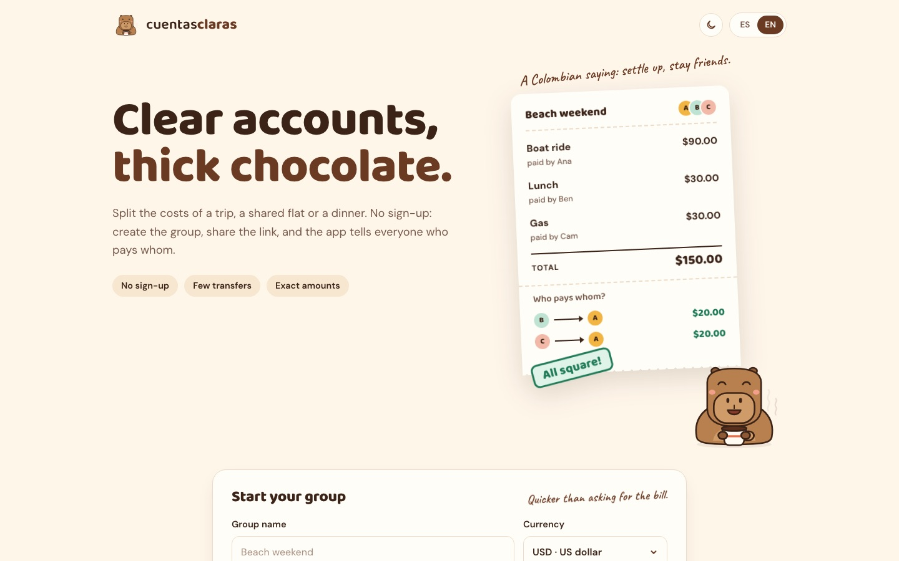
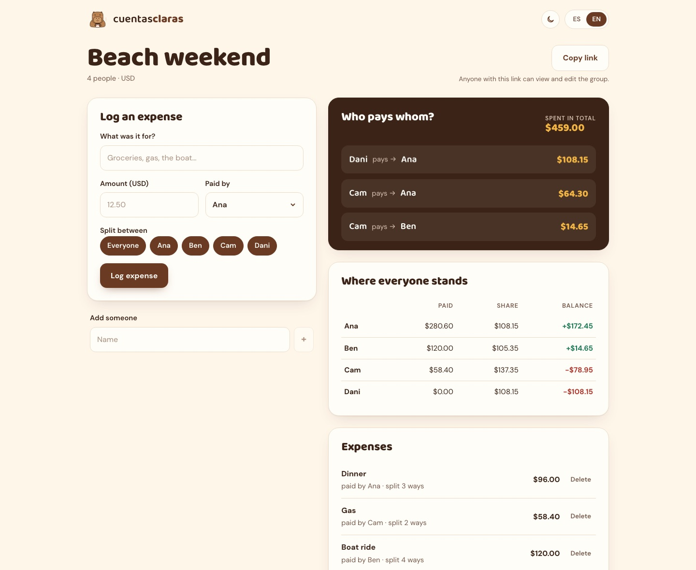
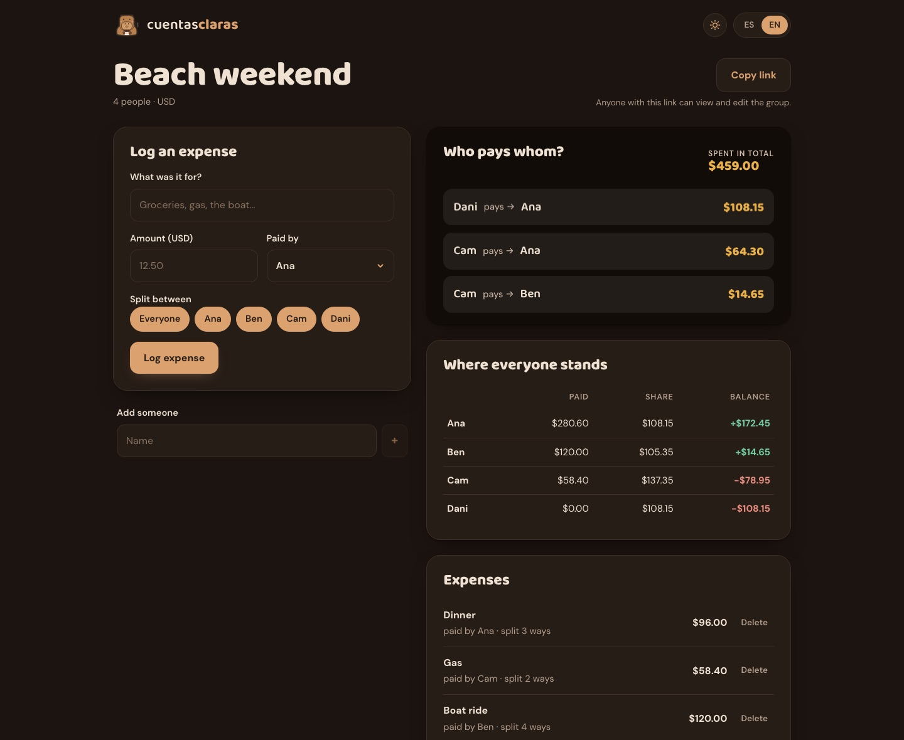
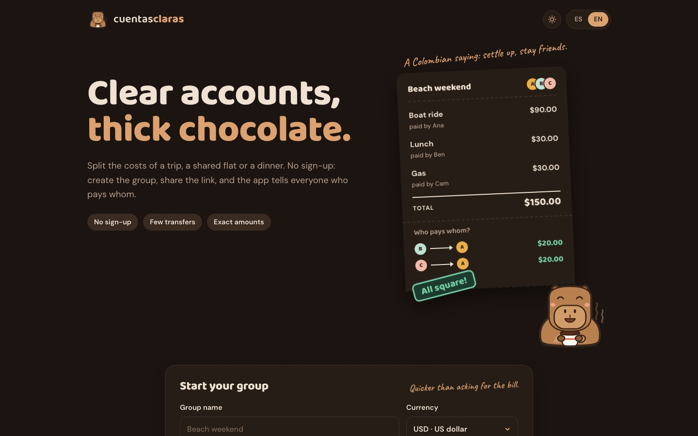
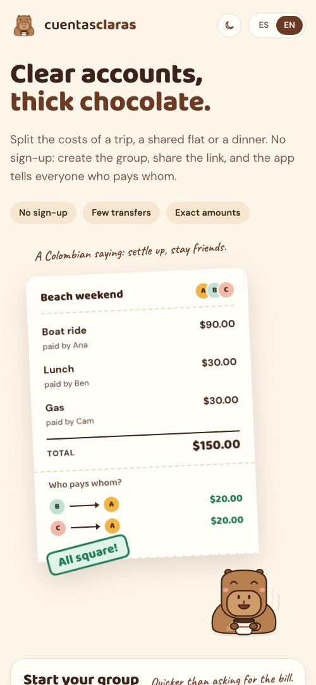

# Cuentas Claras ☕

> *Cuentas claras, chocolate espeso*: a Colombian saying for "settle up and stay friends".

Split shared expenses (a trip, a flat, a dinner) without signing up. Create a group, share the link, log who paid what, and the app tells everyone who pays whom.

**[Live demo](https://cuentas-claras-manuel.vercel.app)** · Spanish and English · light and dark mode



## Screens

| Group in light mode | Group in dark mode |
|---|---|
|  |  |

| Home in dark mode | On a phone |
|---|---|
|  |  |

## How it works

- **The link is the key.** Each group gets a random 10-character code; anyone with the link can view and edit it.
- **Money is exact.** Amounts are stored as integer minor units (cents, or whole pesos for COP/CLP). Uneven splits hand the leftover units to the first participants, so shares always add up to the expense.
- **Few transfers.** Settlement is greedy: whoever owes the most pays whoever is owed the most, repeatedly. Every step settles at least one person, so a group of *n* needs at most *n − 1* transfers.

## Project structure

```
cuentas-claras/
├── backend/                         Spring Boot API (package by feature)
│   └── src/main/java/com/manuelceron/cuentasclaras/
│       ├── config/                  CORS and the injectable Clock
│       ├── groups/                  the feature: controller → service → JPA entities and repository, DTOs
│       └── ledger/                  pure money math (splits and settlement), no Spring, unit tested
│   └── src/main/resources/db/migration/   Flyway SQL, the single source of the schema
└── frontend/src/                    React + TypeScript
    ├── app/                         shell: App layout, Header, router, language and theme preferences
    ├── features/
    │   ├── home/                    HomePage, HeroDemo, CreateGroupForm, MembersInput, RecentGroups, HowItWorks
    │   └── group/                   GroupPage, useGroup, GroupLedger, ExpenseForm, AddMemberForm,
    │                                SettlementCard, BalanceTable, ExpenseList, ShareLink
    ├── shared/
    │   ├── api/                     typed HTTP client, response types, error → message mapping
    │   ├── i18n/                    every UI string in Spanish and English
    │   ├── lib/                     money parsing and formatting (+ tests), names, recent groups storage
    │   └── ui/                      Chocolo the mascot and the cacao-bean burst
    └── styles/                      tokens → base → layout → components → mascot → one sheet per screen
```

### Principles it follows

- **Dependencies point inward.** `features/` use `shared/` and `app/`; `shared/` imports nothing from features, and features never import each other.
- **One job per component.** Pages compose; forms own their own state; `useGroup` owns loading; the API client owns HTTP and nothing else.
- **The server is the source of truth.** Every write returns the whole updated group, so the UI never recomputes balances on its own.
- **Validate at the edges.** The browser parses amounts the way people type them (`90.000`, `12,50`); the API validates again and answers with RFC 9457 problem details.
- **Design tokens, not hard-coded colors.** Components read CSS custom properties, so dark mode is one block of new values.
- **Accessible by default.** Real `<form>`, `<label>`, `<fieldset>` and `<table>` markup, `aria-pressed` toggles, live regions for results, and `prefers-reduced-motion` respected.

## API

| Method | Path | |
|---|---|---|
| `POST` | `/api/groups` | `{ name, currency, members: [..] }` → new group |
| `GET` | `/api/groups/{code}` | group with members, expenses, balances and settlements |
| `POST` | `/api/groups/{code}/members` | `{ name }` |
| `POST` | `/api/groups/{code}/expenses` | `{ description, amount, payerId, participantIds }` |
| `DELETE` | `/api/groups/{code}/expenses/{id}` | |

Every write returns the full updated group. Errors are RFC 9457 problem details (`detail` is safe to show). Currencies: COP, CLP (no decimals), USD, EUR, MXN, PEN, ARS.

## Stack

- **Backend:** Java 25, Spring Boot 4 (Web MVC, Data JPA, Validation), PostgreSQL with Flyway migrations, Docker. Tests run the real app on H2 in PostgreSQL mode with the same migration.
- **Frontend:** React 18, TypeScript, Vite. No UI framework: plain CSS with design tokens, self-hosted fonts, and Chocolo the capybara drawn as SVG.

## Run locally

```bash
createdb cuentas_claras
cd backend && DATABASE_URL=jdbc:postgresql://localhost:5432/cuentas_claras DATABASE_USER=$USER DATABASE_PASSWORD= PORT=8090 ./mvnw spring-boot:run
cd frontend && npm install && npm run dev   # http://localhost:5173, talks to :8090
```

Tests: `cd backend && ./mvnw test` · `cd frontend && npm test`

## Deploy

- **API** on Render (`render.yaml`, Docker), database on Neon. Set `DATABASE_URL` as a JDBC URL (`jdbc:postgresql://host/db?sslmode=require`), plus `DATABASE_USER`, `DATABASE_PASSWORD`, and `CORS_ALLOWED_ORIGINS` (the frontend URL).
- **Frontend** on Vercel with root `frontend/` and `VITE_API_URL` pointing at the API.

Made by [Manuel Cerón](https://manuelceron.vercel.app).
